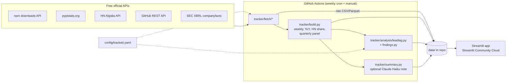

# AI Adoption Tracker

**Do developer-adoption signals lead revenue for data-infrastructure companies?**

A public dashboard that tracks how fast developers and companies adopt AI and data-infrastructure tools,
using free alternative data. It then tests, with pre-registered and autocorrelation-aware statistics,
whether those signals lead the reported revenue of six public companies:
**Snowflake (SNOW), Datadog (DDOG), MongoDB (MDB), Confluent (CFLT), Elastic (ESTC), Cloudflare (NET).**

Part of [Kechun Wu's portfolio](https://kc31415.github.io), alongside
[Morning Brief](https://github.com/KC31415/morning-brief) and [Earnings Desk](https://github.com/KC31415/earnings-desk).

<!-- FINDINGS:START -->
## Headline findings

_Populated from the first full data pull; see `data/processed/findings.md`._
<!-- FINDINGS:END -->

## What's in the app

| Page | What it shows |
|---|---|
| **Home: What moved this week** | Every tracked package: last week vs prior week / prior 4 weeks / last year, plus the latest HN hiring share; optional 3–5 bullet summary written by Claude Haiku |
| **Tool trends** | Weekly downloads (raw + 4-week average), YoY growth, share of *Ask HN: Who is hiring?* posts mentioning the tool, an audit table of matched post snippets, GitHub stats |
| **AI SDK share** | OpenAI vs Anthropic vs Google Gen AI vs Mistral SDK downloads (npm and PyPI): share, absolute, and HN-mention share |
| **Lead-lag study** | Correlations at lags 0–4 quarters for every company × signal with 95% CIs, effective-n p-values, lag-adjusted p, BH q; pooled panel with company and company + quarter fixed effects; a "can and can't tell you" section |
| **Methodology** | Data sources, HN false-positive handling, SEC Q4 derivation, test design and calibration |

## Method in one minute

1. **Signals.** npm daily downloads back to 2016; PyPI daily downloads (pypistats keeps ~180 days, so we
   backfill once and append weekly); share of monthly HN *Who is hiring?* job posts mentioning each tool
   since 2016 (word-boundary alias matching, exclusion phrases, date + context gates for "Claude", "Gemini" and
   "Mistral", and the company's *own* job posts excluded); weekly GitHub snapshots.
2. **Revenue.** SEC XBRL companyfacts → quarterly revenue; **Q4 = full year − 9-month YTD**; fiscal years
   ending in January (SNOW, MDB) and April (ESTC) handled by aggregating every signal over each company's
   exact fiscal-quarter dates.
3. **Test.** For lags k = 0…4: corr(signal log-YoY[t−k], revenue log-YoY[t]). All lags are reported.
   CIs and p-values use a Bartlett **effective sample size** because YoY series are highly autocorrelated.
   This choice came from a [null calibration](docs/null_calibration.md) run *before* the data was pulled:
   a naive test gave up to 58% false positives on independent persistent series, and the n_eff test 1–6%.
   Lag picking is paid for with a Bonferroni-over-lags p; BH q-values cover all company tests.
   A pooled panel with company + calendar-quarter fixed effects guards against a single macro cycle
   driving every company at once.
4. **Verdict rules** ("supported" / "mixed/weak" / "null") are fixed in code
   ([`findings.py`](tracker/analysis/findings.py)) and applied mechanically.

Full details: [docs/METHODOLOGY.md](docs/METHODOLOGY.md). Package → company proxies and why each one was chosen:
[config/tracked.yaml](config/tracked.yaml).

## Architecture



## Repo layout

```
config/tracked.yaml       entities, packages, HN alias rules, analysis settings (one file)
tracker/fetch/            npm.py, pypi.py, hn.py, github.py, sec.py
tracker/hn_match.py       mention matcher (pure functions, unit-tested)
tracker/sec_revenue.py    XBRL → quarterly revenue, Q4 derivation, fiscal labels
tracker/build.py          tidy tables for the app and the study
tracker/analysis/         leadlag.py (tests), findings.py (verdict template)
tracker/pipeline.py       CLI: python -m tracker.pipeline [--sources ...] [--full]
streamlit_app.py, pages/  the dashboard
data/raw, data/processed  committed by the workflow
tests/                    pytest on saved schema fixtures + method tests
scripts/null_calibration.py
```

## Run locally

```bash
pip install -r requirements-dev.txt
```

```bash
pytest -q
```

```bash
SEC_USER_AGENT="Your Name you@example.com" python -m tracker.pipeline
```

```bash
streamlit run streamlit_app.py
```

## Deploy (Streamlit Community Cloud)

<!-- DEPLOY:START -->
See the deploy section below (added in Milestone 4).
<!-- DEPLOY:END -->

## Limitations

- **Small samples**: ~15–30 quarterly YoY observations per company (fewer for CFLT, which IPO'd in 2021),
  and effective samples often under 10. Only large, persistent relationships are detectable.
- **Proxy noise**: downloads include CI/bot traffic and free or open-source use (community MongoDB, Apache Kafka,
  OpenSearch users of Elastic clients). HN skews toward US startups.
- **PyPI history is short** (pypistats ~180 days) and grows weekly; PyPI YoY tests become possible after a year.
- **GitHub stars** only accumulate from the first snapshot (no free historical endpoint).
- Correlation is not causation. **This is a research project, not investment advice.**

## License

MIT
