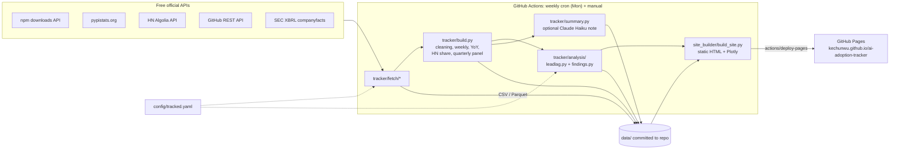
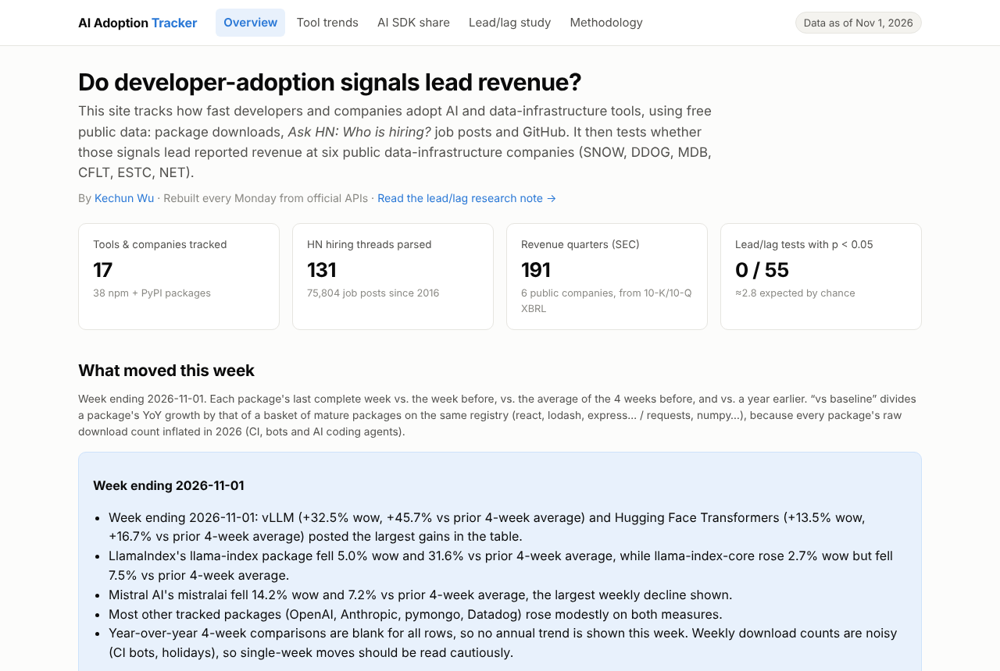
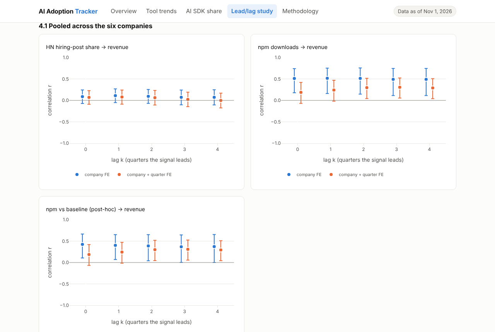
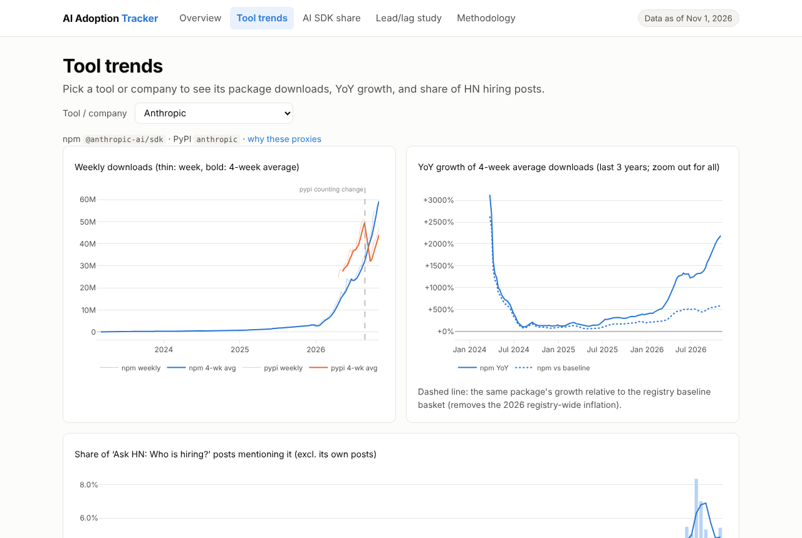
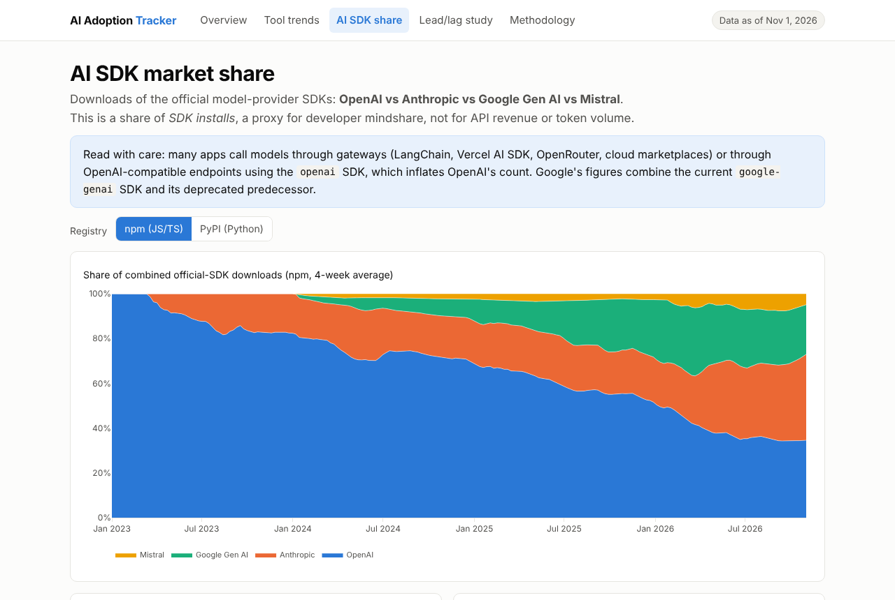

# AI Adoption Tracker

**Do developer-adoption signals lead revenue for data-infrastructure companies?**

**Live site: https://kechunwu.github.io/ai-adoption-tracker** · Part of [Kechun Wu's portfolio](https://kechunwu.github.io),
alongside [Morning Brief](https://github.com/kechunwu/morning-brief) and [Earnings Desk](https://github.com/kechunwu/earnings-desk).

A static website, rebuilt every Monday by GitHub Actions. It tracks how fast developers and companies adopt AI
and data-infrastructure tools, using free alternative data (npm and PyPI downloads, *Ask HN: Who is hiring?*
job posts, GitHub), and tests, with pre-registered and autocorrelation-aware statistics, whether those signals lead
the reported revenue of **Snowflake (SNOW), Datadog (DDOG), MongoDB (MDB), Confluent (CFLT), Elastic (ESTC) and
Cloudflare (NET)**.

<!-- FINDINGS:START -->
## Headline findings

*As of data through the week ending 2026-11-01 (SEC filings through 2026-09). The
[live research note](https://kechunwu.github.io/ai-adoption-tracker/lead-lag.html) regenerates every number weekly.*

- **HN hiring-post share → revenue: null.** Across 6 companies and lags of 0–4 quarters, pooled correlations sit
  between −0.01 and +0.11. Every 95% CI includes zero, and nothing survives the lag adjustment.
- **npm downloads → revenue: co-movement, not a lead.** With company fixed effects, r ≈ +0.5 at *every* lag
  **including lag 0**, flat across lags. That's the signature of a shared growth-decay trend (young products'
  libraries and revenue both decelerate), not of a leading indicator. Three checks:
  - With company + calendar-quarter fixed effects, r falls to +0.19 to +0.31 and no cell survives the lag
    adjustment (best lag-adjusted p = 0.09).
  - In the "acceleration" specification (change in YoY growth on both sides), all 30 pooled cells have p > 0.1.
  - Company by company, 0 of 55 pre-registered tests reach p < 0.05, against ≈2.8 expected by chance. The npm
    correlations are high (median +0.66) but each rests on an effective sample of only ~3–11 observations.
- **Data-quality findings along the way:**
  - npm's API reported zeros for every package on 14 days.
  - npm download growth inflated registry-wide in 2026; MongoDB's driver went from +34% to +129% YoY with no
    business reason.
  - pypistats counts fell 35–55% for every package on 2026-08-25.
  - About 3.7% of naive HN matches were customer or investor lists ("trusted by teams at Anthropic") rather
    than usage.

  All are detected, documented, and handled in the pipeline.
- **AI SDK share (npm, 4-week average):** OpenAI's SDK fell from ~55% to ~35% of combined official-SDK downloads over
  the past year, while Anthropic's rose from ~20% to ~38%. In HN job posts, mentions of Anthropic/Claude reached about
  5% of all posts in 2026, ahead of OpenAI (~2.4%).

**Bottom line:** in this data, developer-adoption signals *track* the long arc of these companies' growth but do not
*lead* revenue by a detectable margin. That's a useful negative result for anyone tempted to trade on download charts,
with the caveats of small samples and noisy proxies (see Limitations).
<!-- FINDINGS:END -->

## Pages

| Page | What it shows |
|---|---|
| [**Overview**](https://kechunwu.github.io/ai-adoption-tracker/) | What moved this week: each package vs the prior week, prior 4 weeks, a year ago, and vs a registry baseline; the latest HN hiring share; optional short Claude Haiku summary |
| [**Tool trends**](https://kechunwu.github.io/ai-adoption-tracker/trends.html) | Per tool/company: weekly downloads, YoY growth (raw and vs baseline), HN hiring-post share with an audit table of matched post snippets, GitHub stats |
| [**AI SDK market share**](https://kechunwu.github.io/ai-adoption-tracker/ai-sdk.html) | OpenAI vs Anthropic vs Google Gen AI vs Mistral SDK downloads (npm and PyPI) and HN mention share |
| [**Lead/lag study**](https://kechunwu.github.io/ai-adoption-tracker/lead-lag.html) | Research note: question, data, method, findings (including nulls), limitations, every test run |
| [**Methodology**](https://kechunwu.github.io/ai-adoption-tracker/methodology.html) | Sources, HN false-positive rules, data-quality fixes, SEC Q4 derivation, statistics and calibration |

Every page shows **“Data as of …”** (latest complete download week, HN month, SEC filing date, pipeline run time).

## Method in one minute

1. **Signals.**
   - npm daily downloads back to 2016.
   - PyPI daily downloads: pypistats keeps ~180 days, so the pipeline backfills once and then appends weekly.
   - Share of monthly HN *Who is hiring?* job posts mentioning each tool, since 2016. Matching uses word-boundary
     aliases, exclusion phrases, and launch-date plus AI-context gates for "Claude", "Gemini" and "Mistral". It
     skips "trusted by / customers include / ex-" lists and excludes the company's *own* job posts.
   - Weekly GitHub snapshots.
2. **Data quality.** Problems found in the real data and fixed:
   - npm reported zeros for every package on 14 days; those days are filled from the same weekday.
   - npm downloads inflated registry-wide in 2026; growth is also shown relative to a control basket of mature
     packages.
   - pypistats counts fell 35–55% for every package on 2026-08-25; raw YoY across that break is left blank.
3. **Revenue.** SEC XBRL companyfacts → quarterly revenue, with **Q4 = full year − 9-month YTD**. Fiscal years ending
   in January (SNOW, MDB) and April (ESTC) are handled by aggregating every signal over each company's exact
   fiscal-quarter dates.
4. **Test.**
   - For lags k = 0…4: corr(signal log-YoY[t−k], revenue log-YoY[t]). All lags are reported.
   - CIs and p-values use a Bartlett **effective sample size**, because YoY series are highly autocorrelated. This
     choice came from a [null calibration](docs/null_calibration.md) run *before* any data was pulled: a naive test
     flagged up to 58% of unrelated persistent series as "significant"; the n_eff test 1–6%.
   - Lag picking is paid for with a Bonferroni-over-lags p; Benjamini-Hochberg q-values cover all company tests.
   - A pooled panel with company + calendar-quarter fixed effects guards against one macro cycle driving every
     company at once.
5. **Verdict rules** ("supported" / "mixed/weak" / "null") are fixed in code
   ([`findings.py`](tracker/analysis/findings.py)) and applied mechanically. Changes made after seeing the data are
   labelled post-hoc and kept in a separate testing family.

Full details: [docs/METHODOLOGY.md](docs/METHODOLOGY.md). Package → company proxies and why each was chosen:
[config/tracked.yaml](config/tracked.yaml).

## Architecture



## Screenshots

| Overview | Lead/lag study |
|---|---|
|  |  |
| **Tool trends** | **AI SDK share** |
|  |  |

## Repo layout

```
config/tracked.yaml        entities, packages, HN rules, control basket, known breaks, analysis settings
tracker/fetch/             npm.py, pypi.py, hn.py, github.py, sec.py
tracker/hn_match.py        mention matcher (pure functions, unit-tested)
tracker/sec_revenue.py     XBRL → quarterly revenue, Q4 derivation, fiscal labels
tracker/build.py           cleaning + tidy tables (outages, imputation, baseline, breaks)
tracker/analysis/          leadlag.py (tests), findings.py (verdict template)
tracker/pipeline.py        CLI: python -m tracker.pipeline [--sources ...] [--full] [--skip-fetch]
site_builder/              static-site generator (Jinja2 templates + Plotly JSON)
streamlit_local/           optional interactive Streamlit version for local use
data/raw, data/processed   committed by the weekly workflow
tests/                     pytest: API-schema fixtures, matcher rules, SEC math, statistics
scripts/                   null_calibration.py, screenshots.py
.github/workflows/         update-data.yml (weekly pull → site), pages.yml (build + deploy), ci.yml
```

## Run locally

```bash
pip install -r requirements-dev.txt
```

```bash
pytest -q
```

```bash
SEC_USER_AGENT="Your Name you@example.com" python -m tracker.pipeline
```

```bash
python -m site_builder.build_site && python -m http.server -d _site 8000
```

Optional Streamlit version: `pip install -r streamlit_local/requirements.txt && streamlit run streamlit_local/streamlit_app.py`.

## Deployment (GitHub Pages)

<!-- DEPLOY:START -->
<a id="deploy-steps"></a>
The site is plain static files (HTML, CSS, JS and JSON) built by `site_builder/` and published by the
`Build & deploy site` workflow. No server, so nothing goes to sleep.

**One-time setup (repo owner):**

1. Open **github.com/kechunwu/ai-adoption-tracker → Settings** (top tab bar).
2. In the left sidebar, under *Code and automation*, click **Pages**.
3. Under **Build and deployment → Source**, choose **GitHub Actions** from the dropdown. It saves automatically;
   there is no branch to pick.
4. Go to the **Actions** tab → **Build & deploy site** (left list) → **Run workflow** → pick the branch → **Run workflow**.
5. When both jobs (build, deploy) turn green (about 1 minute), the site is live at
   **https://kechunwu.github.io/ai-adoption-tracker**. The URL also appears on the run summary and under Settings → Pages.
6. Optional: on the repo home page click the ⚙︎ next to **About** → Website → paste the URL → Save.

**From then on:** every Monday the **Weekly data pull** workflow fetches data, runs the analysis, commits `data/`,
then calls `Build & deploy site`, so the published site always matches the committed data. Any push to the
repo also redeploys.

**Repository secrets** (Settings → Secrets and variables → Actions → New repository secret):
`SEC_USER_AGENT` (required, "Your Name email@example.com"); `ANTHROPIC_API_KEY` (optional; without it the short
Haiku summary on the Overview page is skipped and everything else still works). `GITHUB_TOKEN` is automatic.
<!-- DEPLOY:END -->

## Limitations

- **Small samples**: about 15–35 quarterly YoY observations per company (fewer for CFLT, which IPO'd in 2021) and
  effective samples often under 30, so only large, persistent relationships are detectable.
- **Proxy noise**: downloads include CI, bot and AI-agent traffic and free or open-source use (community MongoDB,
  Apache Kafka, OpenSearch users of Elastic clients). HN skews toward US startups.
- **PyPI history is short** (pypistats keeps ~180 days) and has a counting break on 2026-08-25. PyPI YoY tests become
  possible after about a year of weekly appends.
- **GitHub stars** only accumulate from the first snapshot.
- Correlation is not causation. **This is a research project, not investment advice.**

## License

MIT
